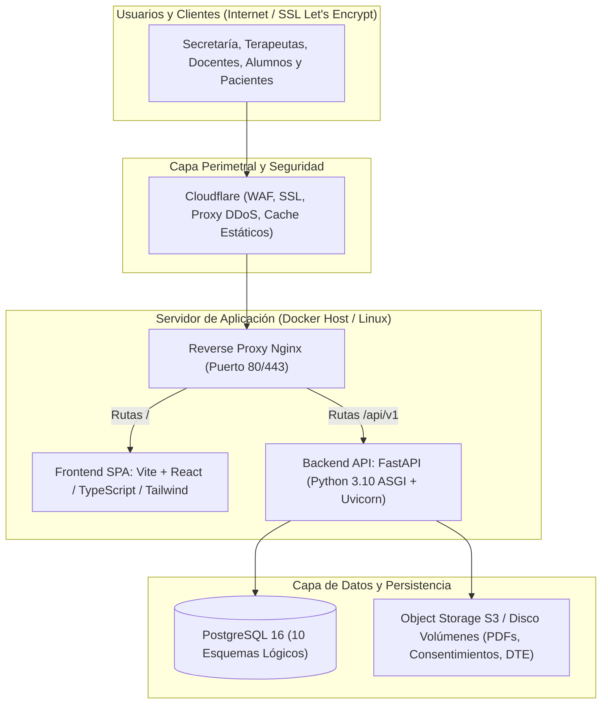

# Ficha Técnica y Guía de Infraestructura de Hosting
## Plataforma Integral San Bao (Academia MTC & Clínica San Bao SpA)

---

## 1. Resumen Ejecutivo del Proyecto

El **Sistema Integral San Bao** es un ERP / Core Institucional de misión crítica que unifica la operación de dos entidades jurídicas:
1. **Instituto de Medicina China Clásica SpA** (Academia, Mallas Curriculares, Dirección y Coordinación Académica, Portal Docente, Alumnos, Matrículas, Aranceles y Certificados).
2. **Servicios Clínicos San Bao SpA** (Clínica Integrativa, Ficha Clínica MTC bajo Ley 20.584, Gestión Asistencial, Programación de Turnos AM/PM/Vespertino de Lunes a Sábado, Boxes, Insumos clínicos y Despachos).

Módulos integrados complementarios:
- **E-Commerce y Pasarela de Pagos** (Venta de cursos, insumos y agendamiento).
- **LMS / Aula Virtual** (Clases teóricas, entregas, seguimiento de avance).
- **Facturación Electrónica SII (DTE)** (Boletas y facturas electrónicas exentas/afectas).
- **RRHH y Remuneraciones** (Contratos, liquidaciones, boletas de honorarios de docentes y terapeutas).

---

## 2. Perfil Operativo y Requisitos de Disponibilidad

### 2.1. Ventana de Operación Activa
- **Días de Servicio:** Lunes a Sábado (6 días a la semana).
- **Horario Crítico:** 08:30 a 22:30 hrs continuo.
  - **Turno AM:** 10:00 a 14:00 hrs (Atención clínica boxes, clases teóricas matutinas).
  - **Turno PM:** 15:00 a 19:00 hrs (Atención clínica boxes, prácticas supervisadas).
  - **Turno Vespertino:** 18:00 a 22:00 hrs (Clases vespertinas, atención clínica nocturna).
- **Domingos:** Actividad clínica cerrada. Ventana designada para mantenimiento preventivo, actualizaciones y copias de seguridad profundas.

### 2.2. Nivel de Servicio Requerido (SLA)
- **Disponibilidad Objetivo:** **99.9% en horario hábil** (lunes a sábado).
- **Tolerancia a Caídas en Horario Operativo:** Mínima. Una caída durante turno clínico interrumpe el registro obligatorio de fichas clínicas (Ley 20.584), el cobro en recepción y el despacho de insumos en box.
- **RTO (Recovery Time Objective):** Menor a 30 minutos ante fallo total de servidor.
- **RPO (Recovery Point Objective):** Menor a 1 hora (máxima pérdida de datos admisible en caso de catástrofe).

---

## 3. Arquitectura Tecnológica del Software



### Componentes Técnicos Detallados:
1. **Frontend:**
   - Single Page Application (SPA) construida con **Vite + React / TypeScript** y estilos con **Tailwind CSS**.
   - Servida mediante **Nginx** optimizado con compresión Gzip/Brotli y caché de activos estáticos.
2. **Backend:**
   - API RESTful en **FastAPI** (Python 3.10+), servidor ASGI **Uvicorn**, validaciones **Pydantic v2**.
   - ORM **SQLAlchemy 2.0** con pool de conexiones (`QueuePool`).
3. **Base de Datos:**
   - **PostgreSQL 16** con 10 esquemas lógicos independientes (`core`, `academic`, `clinical`, `finance`, `hr`, `ecommerce`, `lms`, `integrations`, `bi`, `audit`).
   - Extensiones: `pgcrypto` (cifrado y hashes) y `uuid-ossp` (identificadores estándar).
4. **Almacenamiento de Archivos:**
   - Documentos tributarios DTE (PDF/XML), diplomas y certificados emitidos, fichas firmadas con hash digital SHA-256, material de clases LMS.

---

## 4. Dimensionamiento de Hardware (Sizing)

Se definen 3 fases de capacidad según el volumen de concurrentes (alumnos, terapeutas y pacientes):

| Recurso | Fase 1: Lanzamiento y Piloto (Hasta 150 alumnos / 30 boxes diarios) | Fase 2: Operación Regular (300-800 alumnos / 2 sedes activas) | Fase 3: Alta Escala (>1.000 alumnos / Multisede nacional) |
| :--- | :--- | :--- | :--- |
| **vCPU** | 2 vCPU (AMD EPYC o Intel Xeon) | 4 vCPU dedicadas o de alto rendimiento | 8 vCPU |
| **Memoria RAM** | **4 GB** (mínimo recomendado para Postgres 16 + FastAPI + Nginx) | **8 GB a 16 GB** | 16 GB a 32 GB |
| **Almacenamiento** | 60 GB SSD NVMe | 120 GB - 200 GB SSD NVMe | 500 GB SSD NVMe |
| **Conexiones PG** | Pool max 30 conexiones activas | Pool max 80 conexiones activas | Pool max 150+ con PgBouncer |
| **Ancho de Banda** | 1 TB a 2 TB / mes | 4 TB a 5 TB / mes | Tráfico no medido / 10 Gbps red |

> [!IMPORTANT]
> **Memoria RAM crítica:** PostgreSQL 16 con 10 esquemas y FastAPI en producción requieren **al menos 4 GB de RAM** como piso absoluto en un servidor unificado. Con 2 GB el sistema se arriesga a caídas por OOM (*Out Of Memory Killer*) al generar reportes o PDFs.

---

## 5. Comparativa de Opciones de Hosting y Proveedores

### Opción A: Servidor VPS con Docker (Mayor control y mejor relación costo/beneficio)
Se contrata un VPS en un proveedor cloud internacional con datacenter de baja latencia hacia Chile (Santiago o São Paulo).
- **Proveedores recomendados:**
  - **Hetzner Cloud** (Excelente precio/rendimiento en Europa/USA; requiere Cloudflare para latencia en Chile).
  - **DigitalOcean** / **Linode (Akamai)** (Región São Paulo o US-East).
  - **Vultr** (Tiene datacenter directo en **Santiago de Chile**, latencia < 15ms).
- **Especificaciones recomendadas:**
  - 4 vCPU, 8 GB RAM, 160 GB NVMe SSD.
- **Costo estimado:** **\$25 a \$45 USD/mes** (~$24.000 a $43.000 CLP/mes).
- **Pros:** Costo fijo predecible, control total de los contenedores Docker existentes (`docker-compose.yml`), muy fácil de migrar.

### Opción B: Cloud Híbrido con Base de Datos Administrada (Máxima Confiabilidad)
El backend y frontend corren en un VPS o PaaS, pero PostgreSQL se aloja en un servicio administrado con copias automáticas punto en el tiempo (PITR) y failover.
- **Proveedores:**
  - **DigitalOcean Managed Database (PostgreSQL 16)** o **AWS RDS PostgreSQL** + Droplet/EC2 para la app.
  - **Railway / Render** para Backend + Frontend y Managed PG.
- **Costo estimado:** **\$60 a \$110 USD/mes** (~$58.000 a $105.000 CLP/mes).
- **Pros:** Cero mantenimiento de base de datos, backups automáticos cada minuto, alta disponibilidad nativa 99.95%.

### Opción C: Cloud Empresarial Local en Chile (Cumplimiento normativo y latencia mínima)
Para instituciones de salud que requieran almacenamiento de datos médicos estrictamente dentro del territorio chileno:
- **Proveedores:** **Entel Cloud**, **Claro Cloud**, **Gtd**, o regiones locales de **AWS Santiago (Local Zone)** / **Google Cloud Santiago (southamerica-west1)**.
- **Costo estimado:** **\$120 a \$250 USD/mes**.
- **Pros:** Facturación en pesos chilenos con factura local, latencia ultra baja (< 10ms) en Santiago y regiones.

---

## 6. Estrategia de Alta Disponibilidad (Lunes a Sábado)

Para garantizar que el servicio nunca se interrumpa durante los turnos operativos:

### 1. Perímetro con Cloudflare (Gratuito / Pro)
- Cloudflare se coloca frente al dominio institucional (`sanbao.cl` o `portal.sanbao.cl`).
- **Beneficios:**
  - Certificado SSL automático renovado sin caídas.
  - Protección activa contra ataques DDoS o sobrecarga.
  - Caché de los archivos JS/CSS del frontend en servidores de Santiago, reduciendo un 60% la carga en el servidor principal.
  - Página de espera (*Always Online*) en caso de reinicio de la API.

### 2. Política de Reinicio Automático de Contenedores
- Configurar en `docker-compose.yml`:
  ```yaml
  restart: always
  ```
- Si Uvicorn o PostgreSQL llegaran a fallar por un consumo imprevisto, el daemon de Docker los reinicia automáticamente en menos de 5 segundos sin intervención humana.

### 3. Copias de Seguridad (Backup) Automatizadas y Redundantes
- **Backups Diarios de Base de Datos:**
  - Tarea programada (Cron) de `pg_dump` ejecutada a las **03:00 AM** (fuera de turnos clínicos).
  - Retención: 7 días de respaldos diarios, 4 respaldos semanales y 12 mensuales.
- **Respaldo Fuera de Sitio (Off-site Storage):**
  - Los archivos `.sql.gz` cifrados con GPG se envían automáticamente a un bucket S3 o Cloudflare R2 externo.
  - Aunque el servidor principal sufra una falla catastrófica de hardware, la información de pacientes y alumnos está a salvo externamente.

### 4. Monitoreo y Alertas en Tiempo Real
- Implementar un monitor de disponibilidad externo tipo **UptimeRobot** o **BetterStack** (nivel gratuito suficiente).
- Consulta cada 60 segundos el endpoint de salud `GET /api/v1/health` o `/docs`.
- Si el servidor no responde durante más de 2 minutos consecutivos, envía alertas automáticas inmediatas vía **WhatsApp, Telegram y correo electrónico** al equipo técnico.

---

## 7. Lista de Chequeo para Contratar el Hosting

Cuando cotices con un proveedor o empresa de hosting, solicita exactamente lo siguiente:

- [ ] **Sistema Operativo:** Ubuntu Server 22.04 LTS o 24.04 LTS (64-bit).
- [ ] **Capacidad Mínima:** 4 vCPU, 8 GB de Memoria RAM, 100+ GB almacenamiento SSD NVMe.
- [ ] **Acceso Administrativo:** Acceso SSH con llaves públicas (Root o Sudoer).
- [ ] **Soporte Docker:** Compatibilidad nativa con Docker Engine y Docker Compose v2.
- [ ] **Dirección IP:** 1 IP pública IPv4 estática dedicada (para configurar registros DNS institucionales y certificación de firma SII).
- [ ] **Puertos Habilitados:** 80 (HTTP), 443 (HTTPS) y 22 (SSH).
- [ ] **SLA de Conectividad:** 99.9% o superior garantizado por contrato.
- [ ] **Política de Backups del Proveedor:** Snapshots automáticos del disco completo (mínimo 1 snapshot semanal).
